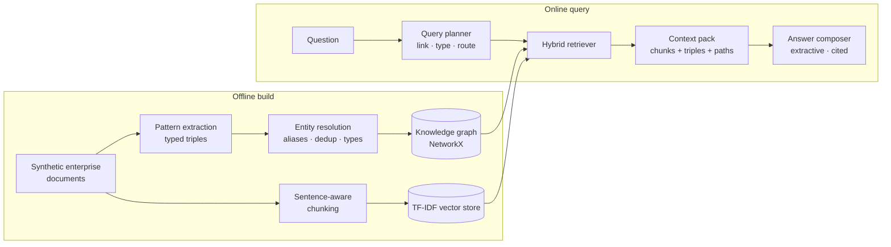

# Knowledge Graph-Powered RAG Assistant (GraphRAG)

Retrieval that reasons over **entities and relationships**, not just text
chunks. This project builds a knowledge graph from enterprise documents, then
answers questions by fusing classic chunk search with **multi-hop graph
traversal** — and proves the difference with a head-to-head eval: on multi-hop
questions, chunk-only RAG scores **0%** while GraphRAG scores **100%**.

> **The demo question.** *"Which supplier supplies parts for the product
> whose returns are handled by the team led by Priya Nair?"*
> The answer (**Helix Components**) requires a 4-hop chain —
> leader → team → returns portal → product → supplier — spread across four
> different documents. No single chunk contains it, so chunk-only RAG
> abstains. GraphRAG walks the path and cites it.

## Why this exists

Chunk-based RAG retrieves *similar text*. Enterprise questions are usually
about *connected facts*: ownership, dependencies, suppliers, escalation
paths. When the connecting facts live in different documents, similarity
search cannot assemble them. A knowledge graph can — it stores the
connections explicitly and can traverse them at query time, returning not
just an answer but the **path** that justifies it.

## Architecture



Key design points:

- **Deterministic, offline extraction.** A pattern grammar extracts typed
  triples (`leads`, `owns`, `depends_on`, `supplies_part_for`, …) — no LLM,
  no network — so the graph, and therefore the eval, is reproducible.
- **Entity resolution with an audit trail.** Mentions are canonicalised via
  exact match, an alias table, and token containment; every merge decision
  is recorded.
- **Query planner.** Links entities in the question, infers the answer's
  entity type, detects multi-hop phrasing, and routes: graph / hybrid /
  chunks.
- **Path-level citations.** Graph answers cite the traversal itself, e.g.
  `[path] Priya Nair -[leads]-> Support Operations Team -[operates]->
  Returns Portal -[handles_returns_for]-> Aero Blender Pro
  <-[supplies_part_for]- Helix Components`, plus each hop's source sentence.
- **Honest baseline.** The chunk-only mode abstains when its best passage
  doesn't ground an answer — the same failure mode production RAG exhibits
  on multi-hop questions.

See [docs/architecture.md](docs/architecture.md) for the full design.

## Quickstart

```bash
python -m venv .venv && source .venv/bin/activate
pip install -r requirements.txt
pip install -e .

python examples/demo.py     # the multi-hop demo, both modes side by side
python eval/run_eval.py     # chunk-only vs hybrid comparison
pytest                      # 52 tests
```

Run the API:

```bash
uvicorn graphrag.api:app --port 8000
```

Or with Docker:

```bash
docker build -t knowledge-graph-rag-assistant .
docker run -p 8000:8000 knowledge-graph-rag-assistant
```

## API

| Endpoint | Description |
|---|---|
| `GET /health` | Liveness + graph size |
| `POST /ask` | Answer a question; body: `{"question": "...", "mode": "hybrid" \| "graph" \| "chunks"}` |
| `GET /graph/stats` | Entity/relation statistics |
| `GET /graph/entity/{name}` | All facts touching an entity (aliases accepted) |
| `GET /documents` | Corpus listing |

Example:

```bash
curl -s -X POST localhost:8000/ask -H 'Content-Type: application/json' -d '{
  "question": "Which supplier supplies parts for the product whose returns are handled by the team led by Priya Nair?",
  "mode": "hybrid"
}'
```

```json
{
  "answer": "Helix Components",
  "strategy": "graph-path",
  "explanation": "Helix Components. Reached in 4 hop(s): Priya Nair -[leads]-> Support Operations Team -[operates]-> Returns Portal -[handles_returns_for]-> Aero Blender Pro <-[supplies_part_for]- Helix Components. Evidence: ...",
  "citations": ["[path] Priya Nair -[leads]-> ... ", "[org-chart] ..."]
}
```

The same call with `"mode": "chunks"` returns `"answer": null` — the
baseline cannot ground the chain.

## Eval results

`python eval/run_eval.py` over 8 questions (4 factoid, 4 multi-hop) against
the synthetic corpus (26 entities, 29 typed edges):

| Question kind | Chunk-only RAG | Hybrid GraphRAG |
|---|---|---|
| Factoid (single-hop) | **100%** | **100%** |
| Multi-hop (2–4 hops) | **0%** | **100%** |
| Overall | 50% | **100%** |

Multi-hop questions ship with their gold reasoning chains in
[eval/eval_questions.json](eval/eval_questions.json), and the eval is wired
into the test suite as a regression gate (`tests/test_eval.py`).

## Project layout

```
src/graphrag/
  corpus.py       synthetic enterprise documents (fictional company)
  extraction.py   pattern-based triple extraction + entity resolution
  graph_store.py  NetworkX graph: stats, neighbourhoods, path search
  chunking.py     sentence-aware chunks (citation units)
  embeddings.py   TF-IDF vector store (dense-embedding seam)
  planner.py      query planning: entity linking, target typing, routing
  retrieval.py    hybrid fusion into a cited context pack
  answering.py    extractive answer composition (graph & chunk strategies)
  api.py          FastAPI service
eval/             comparison eval (chunk-only vs hybrid) + question set
examples/         runnable demo + sample questions
tests/            52 pytest tests across all modules
docs/             architecture notes + CI workflow (reference copy)
```

## Testing

```bash
pytest            # unit + API + eval-regression tests
pytest -q tests/test_answering.py   # just the end-to-end contrast
```

## Limitations

- **Synthetic, small corpus.** 8 documents / 26 entities, chosen so every
  behaviour is inspectable. Real corpora need extraction recall work.
- **Pattern extraction, not learned extraction.** The grammar covers the
  relation phrasings in the corpus; paraphrases outside it are missed. The
  module is the seam for LLM-based extraction.
- **TF-IDF, not dense embeddings.** Deliberate (offline, deterministic), but
  lexical: synonyms without token overlap won't match on the chunk side.
- **Extractive answers.** The composer commits to an entity and shows
  evidence; it does not generate fluent prose. The context pack is designed
  to feed an LLM generator in production.
- **Heuristic planner.** Transparent rules instead of a trained router;
  ambiguous questions can be misrouted (the plan is returned in every API
  response so misroutes are debuggable).

## Roadmap

- LLM-based extraction with the pattern grammar as a validation layer
- Dense embeddings + reciprocal-rank fusion for the chunk/graph blend
- Property-graph backend (Neo4j/Neptune) behind the `KnowledgeGraph` API
- Incremental graph updates with per-edge confidence and provenance decay
- Community detection + graph summarisation for corpus-level questions
  ("what changed in the supply chain this quarter?")
- Larger adversarial eval set: alias collisions, contradictory sources,
  questions whose gold chain exceeds the hop budget

## License

MIT — see [LICENSE](LICENSE).
